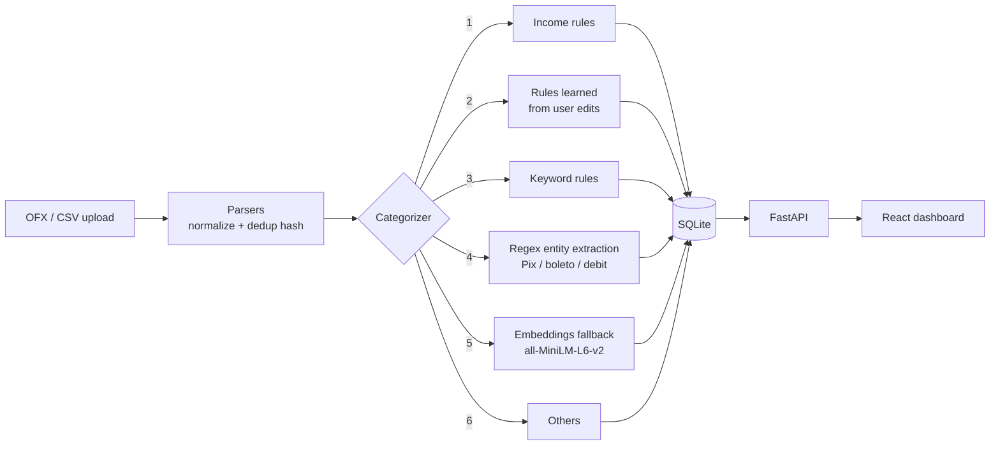

# Finance Dashboard

Personal-finance analytics for bank statements, with a **hybrid transaction categorizer**:
deterministic rules first, a learning loop from user corrections, and a semantic-embedding fallback.

> Built for my own household finances. Everything in this repository uses **synthetic demo data**:
> no real statements, balances or merchants.

## Why

Brazilian bank exports (OFX/CSV) come with free-text descriptions such as
`Transferência enviada pelo Pix - <name> - <doc>`. Spreadsheets break down quickly:
categories drift, the same merchant shows up in ten spellings, and nobody re-categorizes
hundreds of rows by hand every month.

## How categorization works



Design choices:
- **Deterministic first, ML last.** Rules are explainable and cheap. The embedding model only runs
  when no rule matches, and only accepts a match above a confidence threshold. Below that,
  the transaction goes to "Others" instead of a confident wrong guess.
- **Learns from corrections.** When the user re-categorizes a transaction, a rule is stored and
  applied on the next import (`learn_from_override`).
- **Idempotent imports.** Each transaction gets a hash (date, description, amount, person, FITID),
  so re-uploading the same statement never duplicates rows.
- **Entity extraction.** Regexes pull the counterpart out of Pix/boleto/debit descriptions, so rules
  match the merchant and not the boilerplate around it.

## Features

- OFX and CSV import with automatic bank detection and internal-transfer filtering
- Transactions per person, with "individual / shared" split rules
- Budgets per category and person, with alerts
- Insights: anomaly detection, category trends, recurring-charge detection
- Investments tracker, financial targets, pivot table and Excel export
- 9-page React UI: Overview, Transactions, Budget, Insights, Investments, Planning, Pivot, Rules, Upload

## Stack

| Layer | Tech |
|---|---|
| API | Python, FastAPI, SQLAlchemy, SQLite, pandas |
| Categorization | Keyword/regex rules + Sentence-Transformers (`all-MiniLM-L6-v2`, CPU) |
| Frontend | React 19, TypeScript, Vite, Tailwind CSS, TanStack Query, Recharts |

## Run locally

```bash
# backend
python -m venv .venv && source .venv/bin/activate   # Windows: .venv\Scripts\activate
pip install -r requirements.txt
uvicorn api:app --port 8050 --reload

# frontend (another terminal)
cd frontend && npm install && npm run dev
```

Open http://localhost:5173 and upload `samples/sample_statement.ofx` on the **Upload** page.
On Windows, `start.bat` starts both.

## Roadmap

- [ ] pytest suite for parsers, categorizer and insights
- [ ] Docker Compose (API + frontend)
- [ ] Optional LLM tier between keywords and embeddings, with structured output and cost tracking
- [ ] Categorization accuracy report on a labelled synthetic dataset

## License

MIT
